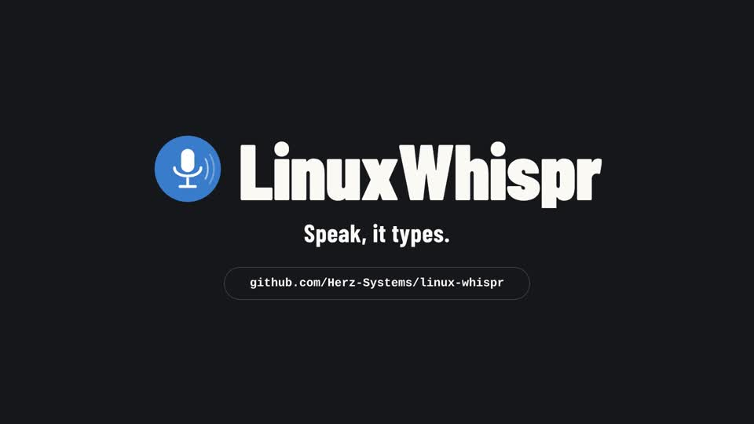

# LinuxWhispr

**Local-first voice dictation for Linux.** LinuxWhispr records from your
microphone, transcribes locally, and pastes the processed text into the focused
application. It combines a native Qt tray and recording overlay with a local web
dashboard.

## Demo

[](docs/assets/linux-whispr-demo.mp4)

[Watch the 28-second demo](docs/assets/linux-whispr-demo.mp4) — voice dictation,
text insertion, the settings dashboard, and custom dictionary corrections.

The demo shows F12; the dictation hotkey is configurable.

## Contents

- [Install](#install)
- [Use LinuxWhispr](#use-linuxwhispr)
- [Dictionary packs and corrections](#dictionary-packs-and-corrections)
- [Configuration and local data](#configuration-and-local-data)
- [Local AI refinement with Ollama](#local-ai-refinement-with-ollama)
- [Troubleshooting](#troubleshooting)
- [Development](#development)

## What it includes

- Local transcription with [faster-whisper](https://github.com/SYSTRAN/faster-whisper)
  by default; optional local `whisper.cpp` with AMD Vulkan acceleration.
- A configurable global dictation hotkey, voice-activity auto-stop, and
  clipboard-based text injection.
- A native Qt tray indicator and non-focus-stealing recording overlay.
- A dashboard bound to `127.0.0.1`, with settings, models, snippets, dictionary
  management, and transcription history. Its interface is available in English,
  Deutsch, Español, and Português.
- Optional local AI refinement through Ollama, and cloud STT or AI backends
  when their optional dependencies are installed and they are explicitly configured.
- Five opt-in bundled dictionary packs containing 151 terms and 113 explicit
  recognized variants, alongside personal entries and learned corrections.

The default configuration does not use a cloud service. The dashboard, models,
configuration, dictionary, and history are local. A configured cloud STT backend
sends audio to its provider; a configured cloud AI backend sends text to its
provider. Review that provider's terms and privacy policy before enabling either.

## Install

LinuxWhispr requires Python 3.10 or newer and [uv](https://docs.astral.sh/uv/getting-started/installation/).
The core desktop UI uses PySide6 and does not require PyGObject.

### System dependencies

Install PortAudio and the Qt runtime libraries for your session. The installer
checks for missing native prerequisites and prints distribution-specific hints.
For text injection, install the helper for the display server you use:

```bash
# Ubuntu / Debian
sudo apt install python3 libportaudio2 libxcb-cursor0 libxkbcommon-x11-0
# X11 text injection
sudo apt install xdotool xclip
# Wayland text injection
sudo apt install wtype wl-clipboard

# Fedora
sudo dnf install python3 portaudio xcb-util-cursor libxkbcommon-x11
sudo dnf install xdotool xclip          # X11
sudo dnf install wtype wl-clipboard     # Wayland

# Arch Linux
sudo pacman -S python portaudio xcb-util-cursor libxkbcommon
sudo pacman -S xdotool xclip             # X11
sudo pacman -S wtype wl-clipboard        # Wayland
```

### Standard install

```bash
git clone https://github.com/Herz-Systems/linux-whispr.git
cd linux-whispr
./install.sh
```

The default install uses the CPU-capable `faster-whisper` backend. The installer
creates a project-local `.venv`, a launcher at `~/.local/bin/linux-whispr` by
default, and an application-menu entry. When an XDG Desktop directory is
enabled, it also creates an executable desktop shortcut. It respects
`XDG_BIN_HOME`, `XDG_DATA_HOME`, and `XDG_CONFIG_HOME`, so those locations may
differ on your system.

Keep the checkout in place: the launcher points to its virtual environment.
Re-run the installer after moving or updating the checkout. Re-running updates
the launcher and desktop assets without replacing configuration, history,
dictionary data, or models. It does not start dictation, enable autostart, or
run `sudo`.

Use `./install.sh --amd` to install the optional AMD/Vulkan runtime. Use
`./install.sh --no-amd` to omit it. With no option, the installer preserves
existing `whisper.cpp` support when it is already configured or installed.

### Optional GTK setup wizard

Normal startup uses the web dashboard and needs no GTK dependencies. The
explicit `--setup` wizard and native settings require GTK4, libadwaita,
their introspection dependencies, and the `gtk` Python extra:

```bash
uv sync --extra gtk
uv run --extra gtk linux-whispr --setup
```

### AMD Vulkan acceleration

AMD Vulkan acceleration uses the optional local `whisper.cpp` backend; it is
separate from the default `faster-whisper` installation.

```bash
# Debian / Ubuntu / Mint build and Vulkan prerequisites
sudo apt install build-essential cmake libvulkan-dev glslc libshaderc1 \
    spirv-headers mesa-vulkan-drivers

# From this checkout
uv sync --extra amd
uv run --extra amd linux-whispr
```

The project builds `pywhispercpp==1.5.1` from source with Vulkan enabled because
its wheels are CPU-only. For a pip-based checkout install, request the local
extra rather than a package from PyPI:

```bash
GGML_VULKAN=1 CMAKE_INSTALL_RPATH='$ORIGIN' CMAKE_BUILD_WITH_INSTALL_RPATH=ON \
  python -m pip install --no-binary=pywhispercpp ".[amd]"
```

After installing, use **Settings → Detect Optimal Setup** to check the actual
runtime and select a suitable backend/model, or select **whisper.cpp (AMD /
Vulkan)** and the **Vulkan** device manually. GGML models are separate from
`faster-whisper` models. When Vulkan cannot initialize, LinuxWhispr reports the
error rather than silently changing to CPU; choose the `cpu` device explicitly
if needed.

## Use LinuxWhispr

Start the installed launcher:

```bash
linux-whispr
```

`linux-whispr` and `linux-whispr-web` are aliases for the same combined
application: each starts the dictation engine and dashboard. On a normal first
launch, the dashboard offers automatic hardware detection; defaults remain
unchanged until you apply a recommendation. Run `linux-whispr --setup` only
to use the optional setup wizard.

While the application runs, the dashboard is available at
`http://127.0.0.1:7865` by default. Opening it does not start recording.

In **Settings → Startup behavior**, independent switches control launching:

- **Launch LinuxWhispr on startup**
  enables desktop-login autostart, not a system service before login. It takes
  effect at the next login and is disabled by default. Switching it off removes
  the application's XDG autostart entry; `XDG_CONFIG_HOME` is respected.
- **Open dashboard on launch** controls only the
  automatic browser window or tab on the next application launch and is enabled
  by default. The dashboard server always starts, even with this switch off.
  You can still open its URL yourself or choose **Open Dashboard** in the tray.
- **Preload local models on launch** is enabled by default. After the dashboard
  and dictation controls are ready, LinuxWhispr prepares the selected cached local
  speech model and, when enabled, the selected local Ollama model in the
  background. This does not download models or warm up cloud backends.

These preferences are saved automatically and apply on the next launch.
The switches share one group without internal dividers, arranged in a grid
on wide screens and stacked on narrow screens.

Dashboard sections have bookmarkable URLs: `/` (Dashboard), `/settings`,
`/history`, `/dictionary`, `/snippets`, and `/models`. Reloading a page keeps
that section open, and browser Back/Forward follows section navigation.

History gives each transcript the full entry width, with its date, app, word
count, duration, and copy/delete actions above the text. Paragraph breaks are
preserved. When refinement changed the text, expand **Original text** to read
the original dictation.

The default transcription language is Portuguese (`pt`). Set `stt.language` to
the ISO 639-1 code you need, or to `auto` for `faster-whisper` language detection.
AI refinement receives the selected transcription language, or the detected
language when automatic detection is enabled. Its system instructions require
preserving the transcription's language rather than translating it, including
mixed-language passages and technical terms. If no language is known, refinement
is instructed to preserve the language of the input text.

In **Settings → AI refinement**, use the **Formal**, **Casual**, **Concise**, or
**Bullet points** quick-action buttons above **Custom prompt**. Clicking one
fills the prompt and saves automatically; edit the text to tailor it. The
**Default** button restores automatic app-context formatting. Custom
instructions replace the default style while preserving the transcription's
language and meaning. Restart LinuxWhispr to apply refinement changes.

1. Press **F12** (the default dictation hotkey) to start recording.
2. Speak.
3. Press **F12** again, or wait for the default 1.2 seconds of silence.
4. LinuxWhispr transcribes, optionally refines and corrects, then pastes the
   result into the focused application.

The tray menu offers **Open Dashboard**, **Start/Stop Dictation**, and **Quit**.
Use `--no-tray` to disable only the indicator; the overlay, dashboard, and
dictation service remain available. The overlay reports readiness, recording,
processing, completion, and errors without taking keyboard focus. On X11 it is
placed using the monitor under the pointer; Wayland compositors control final
placement.

The dashboard stores its selected interface language in browser local storage,
independently of the transcription language. Settings generally take effect
after an application restart. Personal dictionary entries, recognized variants,
and pack selections update the active dictionary and apply to the next
dictation without a restart.

The dashboard uses your system color scheme until you choose a light or dark
theme with its theme control; the browser remembers that choice. On narrow
screens, the menu button opens the same section navigation. The overview shows
the configured dictation shortcut, current setup, usage, and recent transcripts.

Live dictation status appears at the bottom of the sidebar, above the theme
switch. The badge stays visible during background status checks.

### Detect Optimal Setup

On the first dashboard visit, LinuxWhispr checks CPU capacity, available RAM,
GPU memory, and locally usable CUDA/Vulkan runtimes. Run the check again from
**Settings → Detect Optimal Setup**. The settings panel starts collapsed; the
Detect button opens it and runs the check. Once results are available, its heading
lets you expand or collapse them without starting detection; before then the
disclosure control is unavailable. Loading and error messages remain visible.
Hardware memory and setup download estimates use decimal GB with one decimal
place, converted from the underlying MiB values. Other model and disk-size
displays retain MB below 1,000 MB and use one-decimal GB for larger values.
Detection is local and does not download models, install drivers, or change your
settings.

The recommendation favors multilingual `large-v3-turbo` on a usable GPU with
sufficient memory, and smaller models for constrained GPUs or CPU-only systems.
These are conservative memory/latency heuristics, not a benchmark or a guarantee
of the best model for every recording. Software Vulkan renderers such as
llvmpipe are not treated as GPU acceleration; missing dependencies or unknown
memory are reported rather than assumed usable.

Review the detected hardware and model, then select **Download and apply**
(or **Apply setup** for an existing model). The matching backend-specific model
is prepared before settings are saved. Your transcription language and unrelated
settings are preserved. **Restart LinuxWhispr to activate the new STT setup**;
the running engine is not silently reconfigured. Dismissing first-run setup
leaves the manual detection action available. Dashboard configuration also
respects a configuration file selected with `--config`.

## Dictionary packs and corrections

Open **Dictionary → Bundled dictionaries** to enable the vocabulary you need.
All five packs are disabled by default.

| Pack | Terms | Example explicit variant |
| --- | ---: | --- |
| Coding | 42 | `type script` → `TypeScript` |
| DevOps | 31 | `cube control` → `kubectl` |
| AI | 28 | `open ai` → `OpenAI` |
| Email and office | 28 | `attachement` → `attachment` |
| German business | 22 | `e mail adresse` → `E-Mail-Adresse` |

The catalog has 151 terms and 113 explicit recognized variants. Terms without
variants, such as Go, Rust, and Claude, are recognition hints only; they do not
cause broad sound-alike replacement. Enabled vocabulary provides bounded,
personal-first hints to speech recognition and optional AI refinement (at most
1,000 characters per context).

For project names and recurring errors, add a personal word and its
**Recognized variants**, one per line. Adding an existing word with variants
updates those variants. Explicit personal variants take precedence over personal
canonical spellings, learned corrections, and bundled variants. A personal
canonical spelling also overrides a bundled spelling of the same term.

Corrections run once after snippets and optional AI refinement, before text
injection. They match whole tokens rather than identifier substrings and leave
URLs, email addresses, inline code, and fenced code unchanged. Disabling a pack
does not remove personal entries or learned corrections, and bundled terms are
never copied into the personal dictionary.

Adaptive learning is enabled by default, but it is deliberately limited: after
a successful paste, it watches clipboard changes for 15 seconds. If you copy a
sufficiently similar corrected version, it records word-level replacement pairs.
A learned pair becomes active after it has been seen twice. It does not observe
edits directly in other applications.

The independently curated catalog draws on the profile approach in
[Wisper](https://github.com/taraksh01/wisper/tree/main/src-tauri/resources/profiles).
It also references the separation of vocabulary and corrections in
[TypeWhisper term packs](https://github.com/typewhisper/typewhisper-termpacks)
and the recognition-context guidance in
[Voxtype](https://github.com/peteonrails/voxtype/blob/main/docs/USER_MANUAL.md).
No third-party dictionary downloads are required at runtime.

### Community dictionaries

In **Dictionary → Import community dictionary**, choose a UTF-8 JSON/CSV file
or a public HTTPS link. GitHub file links and public Gists are supported; when
a Gist contains multiple compatible files, choose the file to review.

The preview shows the publisher's metadata, terms, recognized variants,
duplicates, and conflicts. Nothing is installed until you select **Confirm
import**. Conflicts require acknowledgement; personal entries keep priority.
Review the source and license before importing third-party vocabulary.

Imported packs appear under **Community dictionaries** and are enabled after
installation. They are stored in the local `dictionary.json`, work offline,
and can be toggled or removed without changing personal entries or bundled
packs. Changes apply to the next dictation without restarting.

Updates are manual: use **Check for updates** for a URL-backed pack or
**Replace file** for a file-backed pack. Review the added, removed, and changed
entries before confirming. Updating preserves the pack's enabled/disabled
state. Sources are never checked automatically.

The native JSON format is versioned:

```json
{
  "format": "linux-whispr-dictionary",
  "schema_version": 1,
  "id": "my-ai-vocabulary",
  "name": "My AI vocabulary",
  "license": "CC0-1.0",
  "entries": [
    {"word": "ChatGPT", "aliases": ["JetGPT"]},
    {"word": "Ollama"}
  ]
}
```

The JSON Schema is available from the running dashboard at
`/api/dictionary/schema`. Optional metadata includes `author`, `description`,
and `sources` (objects with `title` and `url`). A term without aliases is a
recognition hint, not a broad sound-alike replacement. Publisher IDs never
overwrite an existing pack automatically.

Wispr-compatible CSV has no header: one column is a recognition hint, and
two columns mean `heard,corrected`. For example:

```csv
JetGPT,ChatGPT
Ollama
```

Imports are limited to 1 MiB of UTF-8 content, 5,000 terms, 20,000 aliases,
and 200 characters per term or alias. Ambiguous aliases within a file,
unsupported versions, and malformed data are rejected. Remote imports use
public HTTPS on port 443 only; private/local destinations and unsafe redirects
are rejected. Importing or checking a URL contacts its host (and GitHub's API
for Gists); ordinary use of an installed pack does not require that connection.

## Configuration and local data

By default, configuration and dictionary data are stored under
`~/.config/linux-whispr/`; models and history are under
`~/.local/share/linux-whispr/`. The application follows
`XDG_CONFIG_HOME` and `XDG_DATA_HOME`, so use the corresponding paths when
those variables are set:

- `config.toml`, `dictionary.json`, and `snippets.toml` are in
  `$XDG_CONFIG_HOME/linux-whispr/`.
- `history.db` and `models/` are in `$XDG_DATA_HOME/linux-whispr/`.

For example, edit the default configuration at
`~/.config/linux-whispr/config.toml`:

```toml
preload_models = true       # prepare already cached local models in the background

[hotkey]
dictation = "F12"

[stt]
backend = "faster-whisper"  # or "whisper-cpp" for the optional AMD runtime
model = "base"
language = "pt"             # ISO 639-1 code; use "auto" to detect language
device = "auto"             # faster-whisper: auto, cpu, cuda; whisper.cpp: auto, cpu, vulkan
compute_type = "auto"       # faster-whisper only

[ai]
enabled = false
backend = "none"            # local, ollama, or an explicitly configured cloud backend

[audio]
silence_duration = 1.2
silence_threshold = 0.5

[injection]
method = "auto"             # auto, wtype, xdotool, ydotool, clipboard-only
preserve_clipboard = false

[adaptive]
enabled = true
watch_window = 15.0
promotion_threshold = 2
```

For `whisper-cpp`, the `auto` device requests Vulkan just like `vulkan`; it
does not silently fall back to CPU.

## Local AI refinement with Ollama

[Ollama](https://docs.ollama.com/) is an optional local refinement backend.
Start its local service, then choose **Settings → AI Refinement → Local
(Ollama)**. LinuxWhispr contacts only `127.0.0.1:11434`, disables proxy use,
rejects redirects, and never downloads a model itself.

The dashboard's searchable selector lists installed local, completion-capable
models. It excludes cloud-routed and embedding-only models. Search by model
name, parameter size, or quantization; selecting a model and enabling
refinement require an application restart.

```toml
[ai]
enabled = true
backend = "ollama"
model = "qwen3.5:4b"
keep_alive_minutes = 15
```

**Keep selected Ollama model ready** offers 5, 15, or 30 minutes; the default is
15 minutes. LinuxWhispr requests this finite residency when preloading and after
each refinement, without periodic keep-alive requests or changing Ollama's global
settings. Ollama can still evict a model under memory pressure. Changing this
setting takes effect after an application restart.

The following recommendations are practical multilingual starting points, not a
dictation-quality benchmark. Download sizes are approximate and runtime memory
use depends on the model and hardware.

| Model | Download | Suggested use |
| --- | ---: | --- |
| [Qwen3 8B](https://ollama.com/library/qwen3:8b) | 5.2 GB | Balanced starting point |
| [Qwen3.5 4B](https://ollama.com/library/qwen3.5:4b) | 3.3 GB | Smaller multilingual option |
| [Qwen3 14B](https://ollama.com/library/qwen3:14b) | 9.3 GB | Larger alternative when more memory is available |
| [Gemma 3 12B](https://ollama.com/library/gemma3:12b) | 8.2 GB | Multilingual alternative; download includes vision components |

For a model that is not installed, the dashboard shows a manual command such as
`ollama pull qwen3.5:4b`; run it yourself, then refresh the model list. If
Ollama or the selected model is unavailable, or generation fails, LinuxWhispr
keeps the original transcription.

## Troubleshooting

- **Wayland hotkeys:** LinuxWhispr uses the XDG Desktop Portal
  `GlobalShortcuts` interface and needs `dbus-python` and PyGObject. A portal
  must grant the shortcut request. If it is unavailable, an X11/XWayland or
  `pynput` fallback may work, but is compositor- and permission-dependent.
- **Text remains on the clipboard:** install and configure an injection helper
  (`xdotool` on X11, or `wtype`/`ydotool` on Wayland). If paste simulation
  fails, LinuxWhispr leaves the text on the clipboard for manual pasting.
- **Dashboard will not start:** check whether another LinuxWhispr instance or
  another process already uses the configured `web.port`, then inspect the
  startup error before choosing a free port and restarting.
- **Vulkan fails to load:** confirm the Vulkan driver and GGML model, then
  select `cpu` for `whisper-cpp` when GPU acceleration is unavailable.

### Dictation latency

Automatic stop waits for the configured `audio.silence_duration` (1.2 seconds by
default). Adjust **Settings → Audio → Silence duration** in 0.1-second steps;
increase it if your normal pauses end dictation too soon. Existing configured
durations are preserved when updating. Press the dictation hotkey again to stop
without waiting for silence.

The first dictation can still wait if background preparation has not finished
or is disabled. Later dictations reuse the loaded speech model. Ollama refinement
can have a cold-start delay again after its configured residency expires.
Preparation failures are nonfatal; normal dictation retries loading on demand.

Speech recognition and optional AI refinement run in sequence. Refinement must
generate the cleaned text, so it can take longer than recognition on long
dictations even when both models use the GPU. Ollama's local-model eligibility
is checked once per refinement, immediately before generation, without caching
the result. Voice detection uses one CPU inference thread to avoid an unnecessary
per-core worker pool for its small recurrent chunks.

## Development

From a repository checkout:

```bash
# Create the development environment. Add retained runtime extras as needed:
# for example, use --extra dev --extra amd or --extra dev --extra gtk.
uv sync --extra dev

# Python tests and static checks
uv run --extra dev pytest
uv run --extra dev ruff check src/
uv run --extra dev mypy src/

# Browser-localization tests
node --test tests/web_i18n.test.js
```

For isolated interface work, start only the dashboard with disposable data:

```bash
preview_root="$(mktemp -d)"
XDG_CONFIG_HOME="$preview_root/config" \
XDG_DATA_HOME="$preview_root/data" \
XDG_CACHE_HOME="$preview_root/cache" \
uv run uvicorn linux_whispr.web.server:app --host 127.0.0.1 --port 7866
```

Open `http://127.0.0.1:7866`. This starts no dictation engine, tray, or global
hotkeys. Changes stay in the temporary directories. The dictation-unavailable
status is expected in this preview; the regular launchers start the combined app.

For History layout checks, include long multiline text, a differing original,
and a long app name. Verify wide and narrow layouts without horizontal scrolling,
and keep search and entry actions easy to reach.

## Architecture

The dictation path is: global hotkey → audio capture → voice-activity detection
→ speech-to-text → snippets → optional AI refinement → dictionary corrections
→ clipboard paste → local history. Components communicate through an internal
event bus. See [`specs/001-linux-whispr/spec.md`](specs/001-linux-whispr/spec.md)
for the project specification.

## License

MIT
